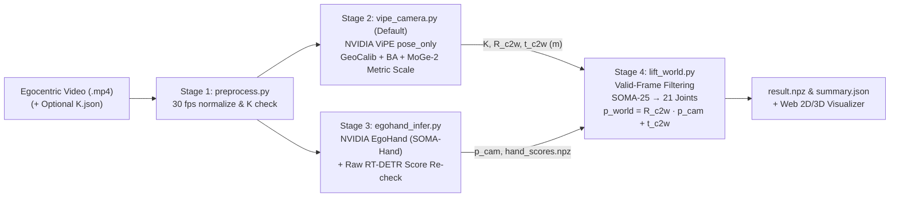
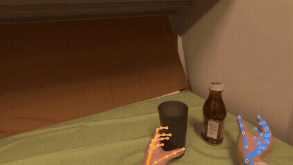
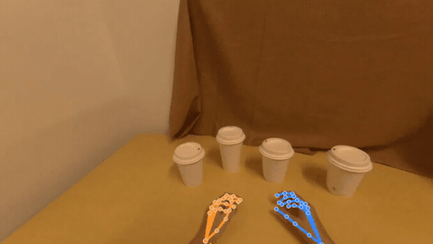
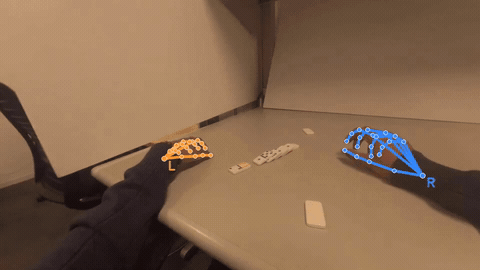
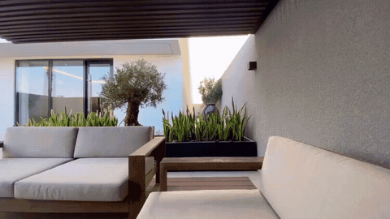

# EgoHandWorld

<p align="center">
  <b>Egocentric Monocular Video &rarr; Metric 3D Hand Motion in World Coordinates</b>
</p>

<p align="center">
  <a href="https://github.com/wangwen-banban/EgoHandWorld/stargazers"></a>
  
  
  
  
</p>

**EgoHandWorld** is an end-to-end pipeline and web visualization platform that reconstructs **metric 3D bimanual hand trajectories in world coordinates** from a single **egocentric RGB video** — **without requiring ground-truth camera intrinsics** and **without hallucinating hands on hand-free scenes**.

### Key Highlights
- **Zero-GT-Intrinsics Metric Camera Tracking**: Uses **NVIDIA ViPE** (`pose_only`) by default to jointly estimate camera focal length (`0.4%–2.6%` error on EgoDex) and metric camera trajectory (`R_c2w, t_c2w`) without depending on hand masks.
- **High-Accuracy 3D Hand Reconstruction**: Pairs ViPE with **NVIDIA EgoHand** (per-frame SOMA-Hand in camera coordinates), reducing world-aligned joint error (**WA-MPJPE**) to **17.7 mm** on EgoDex — **35% lower than HaWoR (CVPR 2025)** and **70% lower than StableHand**, even without GT intrinsics.
- **Zero False Positives on Hand-Free Videos**: Re-verifies every EgoHand tracked box with raw RT-DETR detection confidence (`score_thr / max_gap / min_frames`), completely eliminating hallucinated hands (`150/150 → 0/0` on outdoor hand-free clips).
- **3D Hand-Object Interaction (HOI) & Object Visualization** ([`feat/object-hoi`](https://github.com/wangwen-banban/EgoHandWorld/tree/feat/object-hoi)): Extends the pipeline to 6DoF object tracking & joint hand-object 3D visualization (**Route 3 `FoundationPose` + `K_vipe` + `EgoHand`**), cutting 3D Chamfer error by **53%** and 3D jitter by **51%** vs. *Do As I Do*.
- **Modular & Resumable Engineering**: 4 decoupled subprocess stages with isolated Python environments, `manifest.json` checkpointing, multi-GPU batch scheduling, and an interactive **Web 2D/3D Visualizer**.

---

## 1. Framework & Architecture

EgoHandWorld decouples **hand pose estimation** and **camera trajectory estimation** into independent, specialized stages, then lifts camera-space 3D hand joints into a unified metric world coordinate system (defined by the frame-0 camera pose in OpenCV convention: `+x` right, `+y` down, `+z` forward, in meters).



| Stage | Module | Isolated Env | What It Does |
| :--- | :--- | :--- | :--- |
| **1. Preprocess** | `processors/preprocess.py` | `hawor` | Re-encodes input video to uniform 30 fps; parses optional user-provided intrinsics (`fx, fy, cx, cy` or EgoHand `PINHOLE`). |
| **2. Camera Trajectory** | `processors/vipe_camera.py` *(default)*<br>`processors/hawor_camera.py` *(optional)* | `vipe`<br>`hawor` | **ViPE** jointly optimizes focal length + metric camera pose without hand masks. Can optionally switch to HaWoR masked DROID-SLAM + Metric3D (`camera_backend: hawor`, requires GT intrinsics). |
| **3. Hand Reconstruction** | `processors/egohand_infer.py` | `egohand` | Runs official NVIDIA EgoHand (`bfloat16`, perspective cropping) and re-scores every emitted bounding box using the raw RT-DETR detector (`hand_scores.npz`). |
| **4. World Lifting & Filtering** | `processors/lift_world.py` | `hawor` | Filters false-positive tracks (`score_thr=0.5`, `max_gap=5`, `min_frames=10`), maps SOMA-25 to 21 OpenPose/MANO joints, lifts to world coordinates via `p_world = R_c2w · p_cam + t_c2w`, and writes `result.npz` + `summary.json`. |

---

## 2. Benchmark & Quantitative Results

Evaluated on 4 diverse **EgoDex** egocentric manipulation clips (5 s, 150 frames @ 30 fps each, 7 visible hands total) against Apple Vision Pro ARKit ground truth (`W-MPJPE`, `WA-MPJPE`, `PA-MPJPE` in **mm**, lower is better &darr;).

### 2.1 Comparison with Existing SOTA Methods (EgoDex, mm &darr;)

| Method | Needs GT Intrinsics? | `add-remove-lid` (L / R)<br>WA / PA | `dominoes` (L / R)<br>WA / PA | `drawer` (R)<br>WA / PA | `pour` (L / R)<br>WA / PA | **Mean WA-MPJPE &darr;** | **Mean PA-MPJPE &darr;** |
| :--- | :---: | :---: | :---: | :---: | :---: | :---: | :---: |
| **StableHand** | Yes | 99.6 / 95.8 &nbsp;\|&nbsp; 19.1 / 22.3 | 46.8 / 61.4 &nbsp;\|&nbsp; 14.0 / 16.9 | 40.5 &nbsp;\|&nbsp; 29.8 | 38.1 / 36.0 &nbsp;\|&nbsp; 17.4 / 20.3 | 59.7 mm | 20.0 mm |
| **WiLoR + VGGT** | Yes | 88.6 / 90.5 &nbsp;\|&nbsp; 11.9 / 12.3 | 37.9 / 47.8 &nbsp;\|&nbsp; 10.5 / 10.4 | 24.9 &nbsp;\|&nbsp; 11.0 | 29.2 / 27.1 &nbsp;\|&nbsp; 9.0 / 11.6 | 49.4 mm | 11.0 mm |
| **HaWoR** *(CVPR 2025)* | Yes | 40.7 / 31.9 &nbsp;\|&nbsp; 10.9 / 13.1 | 22.8 / 29.8 &nbsp;\|&nbsp; 9.7 / 11.5 | 24.6 &nbsp;\|&nbsp; 10.1 | 16.9 / 25.3 &nbsp;\|&nbsp; 9.5 / 10.0 | 27.4 mm | 10.7 mm |
| **EgoHand + HaWoR SLAM** | Yes | 26.4 / 24.0 &nbsp;\|&nbsp; 10.4 / 10.7 | 17.4 / 20.3 &nbsp;\|&nbsp; 6.9 / 8.1 | 15.9 &nbsp;\|&nbsp; 9.9 | 9.9 / 13.5 &nbsp;\|&nbsp; 8.3 / 7.6 | 18.2 mm | **8.8 mm** |
| **EgoHandWorld (Ours, GT K)** | Yes | 25 / 22 &nbsp;\|&nbsp; 11 / 11 | 18 / 20 &nbsp;\|&nbsp; 7 / 8 | 17 &nbsp;\|&nbsp; 10 | 10 / 13 &nbsp;\|&nbsp; 9 / 8 | 17.9 mm | 9.1 mm |
| **EgoHandWorld (Ours, Blind / No GT K)** | **No** | **25 / 22** &nbsp;\|&nbsp; 11 / 11 | **18 / 19** &nbsp;\|&nbsp; 7 / 8 | **17** &nbsp;\|&nbsp; 10 | **10 / 13** &nbsp;\|&nbsp; 9 / 8 | **17.7 mm** | 9.1 mm |

> **Takeaway**: **EgoHandWorld** without any ground-truth camera intrinsics achieves **17.7 mm WA-MPJPE** — matching GT-calibrated performance while reducing world-aligned error by **35% vs. HaWoR** and **70% vs. StableHand**.

### 2.2 Blind Camera Intrinsics Accuracy (No GT `K`, GT `fx = 736.6 px`)

Accurate focal length is critical because both monocular hand depth and metric SLAM scale amplify focal errors:

| Sequence | GT `fx` | UniDepth `fx` | **ViPE `fx` (Ours)** | WA-MPJPE (UniDepth) | **WA-MPJPE (ViPE, Ours)** | WA-MPJPE (GT `K`) |
| :--- | :---: | :---: | :---: | :---: | :---: | :---: |
| `add-remove-lid-10` | 736.6 | 1288.5 *(+74.9%)* | **741.0 *(+0.6%)*** | 101 / 106 mm | **25 / 22 mm** | 25 / 22 mm |
| `arrange-topple-dominoes-1` | 736.6 | 1062.6 *(+44.3%)* | **751.1 *(+2.0%)*** | 27 / 21 mm | **18 / 19 mm** | 18 / 20 mm |
| `furniture-bench-drawer-38` | 736.6 | 942.5 *(+28.0%)* | **739.5 *(+0.4%)*** | 17 mm | **17 mm** | 17 mm |
| `pour-12` | 736.6 | 1338.3 *(+81.7%)* | **755.4 *(+2.6%)*** | 14 / 18 mm | **10 / 13 mm** | 10 / 13 mm |

### 2.3 Hand-Free False-Positive Rejection

EgoHand's built-in tracker starts tracks at `0.15` confidence and interpolates across all gaps, causing `150/150` false-positive frames on videos with **no hands**. Re-verifying with raw RT-DETR scores (`score_thr=0.5`, real hands `p10 ≥ 0.76` vs. hand-free `max ≤ 0.44`) fixes this cleanly:

| Video | Hands (L / R) | Raw EgoHand Output | Detector Confirmed | **EgoHandWorld Valid Frames** |
| :--- | :---: | :---: | :---: | :---: |
| Outdoor Street (**No Hands**) | L / R | 150 / 150 *(100% FP)* | 0 / 0 | **0 / 0** *(0% FP)* |
| `furniture-bench-drawer-38` (Right Only) | L / R | 0 / 150 | 0 / 149 | **0 / 150** |
| `add-remove-lid-10` (Both Hands) | L / R | 150 / 150 | 150 / 147 | **150 / 150** |
| `dominoes-1` & `pour-12` (Both Hands) | L / R | 150 / 150 | 150 / 150 | **150 / 150** |

---

## 3. Case Showcases

<table>
  <tr>
    <td align="center" width="50%">
      <br/>
      <b>Pour Water (Bimanual)</b><br/>
      <sub>EgoDex · Smooth bimanual interaction (WA-MPJPE: 10 / 13 mm)</sub>
    </td>
    <td align="center" width="50%">
      <br/>
      <b>Open & Close Lid (Zero GT Intrinsics)</b><br/>
      <sub>ViPE estimated <code>fx=741</code> vs. GT <code>737</code> (WA-MPJPE: 25 / 22 mm)</sub>
    </td>
  </tr>
  <tr>
    <td align="center" width="50%">
      <br/>
      <b>Arrange & Topple Dominoes (Fast Motion)</b><br/>
      <sub>EgoDex · Rapid camera & finger articulation (PA-MPJPE: 7 / 8 mm)</sub>
    </td>
    <td align="center" width="50%">
      <br/>
      <b>Outdoor Courtyard (Hand-Free Video)</b><br/>
      <sub>ViPE tracks camera smoothly; RT-DETR filter rejects 100% of false-positive hands (<code>0/0</code>)</sub>
    </td>
  </tr>
</table>

---

## 3.5 3D Object Reconstruction & Visualization (`feat/object-hoi` Branch)

In addition to bimanual hand reconstruction on `main`, **EgoHandWorld** also supports **zero-GT-intrinsics 3D Object 6DoF Tracking & Joint Hand-Object Visualization** on the dedicated [`feat/object-hoi`](https://github.com/wangwen-banban/EgoHandWorld/tree/feat/object-hoi) branch (see [`object_hoi/README.md`](https://github.com/wangwen-banban/EgoHandWorld/blob/feat/object-hoi/object_hoi/README.md)).

### Best Pipeline: Route 3 (`FoundationPose`) + `K_vipe` + `EgoHand` vs. Baseline (`Do As I Do`)

Evaluated on **TACO** egocentric hand-object manipulation (`brush_bowl`, zero GT intrinsics):

| Method | Intrinsics | **Cam-CD &darr;** | **F@20mm &uarr;** | **Scale Error `\|1-s\|` &darr;** | **3D Jitter &darr;** |
| :--- | :---: | :---: | :---: | :---: | :---: |
| **Baseline: Do As I Do (`HaWoR`)** | MoGe (`K_moge`) | 34.8 mm | 28.9% | 18.4% | 19.02 mm |
| **Baseline: Do As I Do (`EgoHand`)** | MoGe (`K_moge`) | 37.8 mm | 29.5% | 24.1% | 16.73 mm |
| **Ours: Route 3 + `K_vipe` + `EgoHand`** | **ViPE (`K_vipe`)** | **16.4 mm (-53%)** | **69.6% (+40.7%)** | **10.1%** | **9.30 mm (-51%)** |

*(Across the full 6-sequence / 12-object TACO benchmark, **Route 3 + `K_vipe` + `EgoHand`** achieves **24.90 mm Cam-CD**, **51.7% F@20mm**, and **6.9% `|1-s|`** without GT intrinsics — closing ~80% of the gap to GT-calibrated `K_cal` at `21.52 mm`.)*

> **Why does *Do As I Do* jitter?** Its main bottleneck is **inaccurate depth ($Z$) prediction**: single-frame `MoGe` underestimates focal length by `15%–20%` (pulling depth $Z$ closer and inflating scale error), and independent per-frame 2D silhouette optimization is weakly constrained along the camera ray, causing severe frame-to-frame $Z$ oscillation (`19.02 mm` jitter). Replacing `K_moge` with **ViPE (`K_vipe`)** and per-frame optimization with **FoundationPose** temporal 6DoF tracking + **EgoHand** occlusion handling cuts both 3D error and jitter by **>50%**.

<p align="center">
  <br/>
  <sub><b>TACO <code>brush_bowl</code> 3D Hand-Object Visualization</b> — checkout <code>git checkout feat/object-hoi</code> for full object scripts, benchmarks, and visualizations.</sub>
</p>

---

## 4. Repository Structure

```text
EgoHandWorld/
├── assets/                   # Showcase GIFs for documentation
├── configs/
│   └── default.yaml          # Paths, camera_backend (vipe|hawor), ViPE/EgoHand & validity thresholds
├── processors/               # 4 decoupled pipeline stages
│   ├── common.py             # Config loader, manifest helpers, shared utilities
│   ├── preprocess.py         # 30 fps normalization & optional intrinsics parser
│   ├── vipe_camera.py        # [Default] NVIDIA ViPE pose_only camera + intrinsics estimator
│   ├── hawor_camera.py       # [Optional] HaWoR masked DROID-SLAM + Metric3D backend
│   ├── egohand_infer.py      # NVIDIA EgoHand inference + raw RT-DETR score re-verification
│   └── lift_world.py         # Valid-frame filtering, SOMA-25→21 mapping, camera→world lifting
├── tools/                    # CLI entrypoints
│   ├── run_video.py          # Single-video end-to-end runner (resumable via manifest.json)
│   ├── launch_batch.py       # Multi-GPU batch scheduler (waits for min_free_mb per GPU)
│   └── eval_egodex.py        # EgoDex & hand-free regression benchmark script
├── web/                      # Built-in Web 2D/3D visualization platform
│   ├── app.py                # Flask + Gunicorn web server
│   ├── worker.py             # SQLite-backed background task runner
│   ├── render.py             # Generates 2D overlay.mp4 & Three.js web.json
│   ├── manage.py             # Service control: start | stop | restart | status
│   ├── import_case.py        # Import a completed run as a homepage demo case
│   ├── public_tunnel.sh      # Optional Cloudflare Quick Tunnel launcher
│   ├── static/               # CSS + Three.js 3D world viewer (viewer.js)
│   └── templates/            # HTML templates
├── scripts/                  # Environment setup, dependency lockfiles & weight scripts
│   ├── setup_envs.sh         # Builds hawor & egohand uv virtualenvs
│   ├── setup_vipe.sh         # Clones & builds ViPE uv virtualenv
│   ├── fetch_weights.sh      # Downloads required model checkpoints
│   ├── link_weights.sh       # Symlinks checkpoints into repository paths
│   └── freeze_{hawor,egohand,vipe,web}.txt
└── third_party/              # Vendored upstream dependencies (egohand, hawor, chumpy)
```

---

## 5. Quick Start

### 5.1 Environment & Weights Setup

1. Update the root paths (`data_root`, `python.*`, `vipe.*`) in `configs/default.yaml` and the top variables (`B`, `P`, `SRC`) in `scripts/*.sh` to match your machine.
2. Build the isolated environments and fetch checkpoints:

```bash
bash scripts/setup_envs.sh      # Build hawor & egohand environments (uv)
bash scripts/setup_vipe.sh      # Clone nv-tlabs/vipe & build vipe environment
bash scripts/fetch_weights.sh   # Download EgoHand, HaWoR, Metric3D, MANO checkpoints
bash scripts/link_weights.sh    # Create symlinks inside the repo

# Optional: Web UI environment
uv venv /path/to/envs/web --python 3.12
uv pip install --python /path/to/envs/web/bin/python -r scripts/freeze_web.txt
```

### 5.2 Single-Video Inference

```bash
PY=/path/to/envs/hawor/bin/python

# Blind mode (no intrinsics needed — ViPE estimates K and metric camera trajectory automatically)
$PY tools/run_video.py --video /abs/path/to/video.mp4 --gpu 0

# With known intrinsics (JSON with fx, fy, cx, cy or EgoHand PINHOLE format)
$PY tools/run_video.py --video /abs/path/to/video.mp4 --intrinsics /abs/path/to/K.json --gpu 0 --run_dir /path/to/work/exp01
```

### 5.3 Multi-GPU Batch Processing

Create `videos.txt` with one `/abs/video.mp4 [optional /abs/K.json]` per line:

```bash
$PY tools/launch_batch.py --list videos.txt --run_dir /path/to/work/batch_001 --gpus 0,1,2,3
```

### 5.4 Web Visualization Platform

```bash
/path/to/envs/web/bin/python web/manage.py start   # start | stop | restart | status
# Open http://127.0.0.1:5100 (or forward via SSH: ssh -N -L 15100:127.0.0.1:5100 <host>)
```

---

## 6. Output Format (`result.npz`)

Each run writes `<run_dir>/<video_id>/result.npz` and `summary.json`. World coordinates use the **frame-0 camera coordinate frame** (OpenCV: `+x` right, `+y` down, `+z` forward, in meters).

| Field | Shape | Description |
| :--- | :--- | :--- |
| `fps`, `K`, `image_size` | scalar / `(3, 3)` / `(2,)` | Normalized FPS (30), camera intrinsics used (given or ViPE), image `(W, H)` |
| `R_c2w`, `t_c2w` | `(T, 3, 3)`, `(T, 3)` | Per-frame camera-to-world rotation and metric translation (m) |
| `{left,right}_valid` | `(T,)` bool | Valid hand mask after RT-DETR score re-verification |
| `{left,right}_det_score` | `(T,)` | Highest raw detector confidence matched to the hand box |
| `{left,right}_joints_world` | `(T, 21, 3)` | World-space 21 joints (OpenPose/MANO order, meters; `NaN` if invalid) |
| `{left,right}_joints_world_soma25` | `(T, 25, 3)` | World-space SOMA-Hand 25 joints (`NaN` if invalid) |
| `{left,right}_joints_cam` | `(T, 21, 3)` | Camera-space 21 joints (`NaN` if invalid) |
| `{left,right}_soma_*` | — | Raw EgoHand SOMA parameters (`hand_poses`, `identity_coeffs`, `global_scale`, `scale_params`, `cam_t`, `kp2d_presence`, `bbox_cxcys`) |

---

## 7. Acknowledgements

This project builds upon the following open-source works and benchmarks — please refer to their respective repositories and licenses:
- [NVIDIA EgoHand](https://github.com/NVlabs/egohand) (3D egocentric hand reconstruction)
- [NVIDIA ViPE](https://github.com/nv-tlabs/vipe) (zero-GT-intrinsics metric camera pose & intrinsics estimation)
- [HaWoR](https://github.com/ThunderVVV/HaWoR) (optional SLAM camera backend & reference pipeline)
- [FoundationPose](https://github.com/NVlabs/FoundationPose) (`feat/object-hoi` — unified 6DoF object pose estimation & tracking)
- [SAM 3](https://github.com/facebookresearch/sam3) & [SAM 3D Objects](https://github.com/facebookresearch/sam-3d-objects) (`feat/object-hoi` — automated object segmentation & single-view 3D object mesh reconstruction)
- [Do As I Do](https://github.com/do-as-i-do/do-as-i-do) (`feat/object-hoi` — reference HOI reconstruction pipeline & baseline)
- [TACO Dataset](https://taco2024.github.io/) (`feat/object-hoi` — egocentric bimanual hand-object manipulation benchmark)

---

## ⭐ Support

If you find **EgoHandWorld** helpful for your research or engineering projects, please consider giving us a **⭐ Star** on GitHub — it really helps! Issues and pull requests are warmly welcomed.
