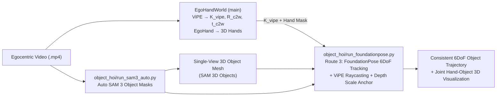
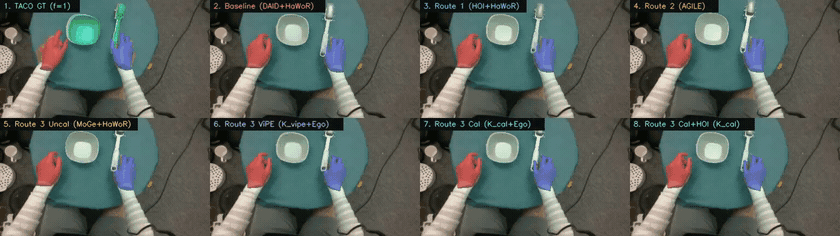
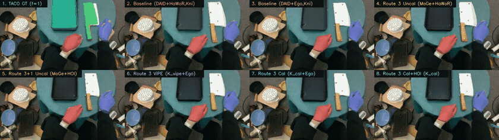
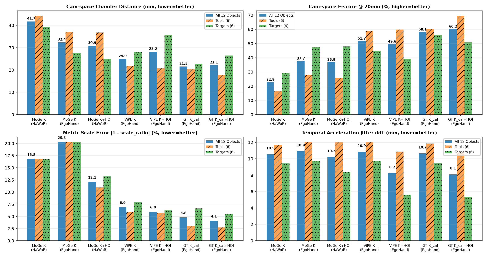
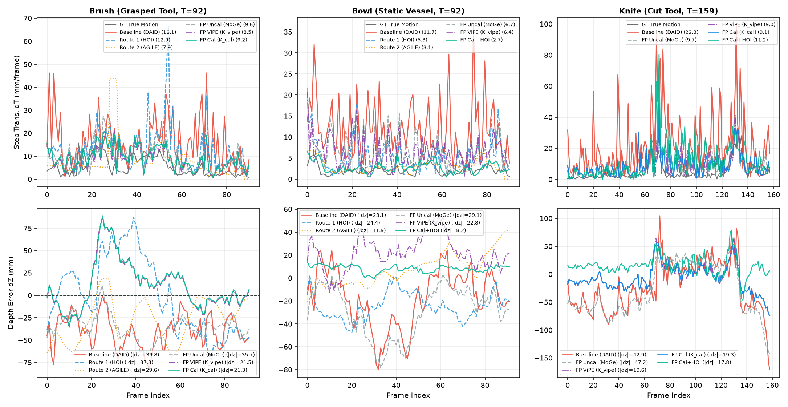

# EgoHandWorld — 3D Hand-Object Interaction (HOI) Extension (`feat/object-hoi`)

This branch extends **EgoHandWorld** (`main`) with **zero-GT-intrinsics 3D Object Reconstruction, 6DoF Pose Tracking, and Joint Hand-Object Visualization** using our best-performing pipeline:

> **Route 3 (`FoundationPose` 6DoF Tracking) + `K_vipe` (ViPE Blind Intrinsics) + `EgoHand` (Hand Occlusion & Metric Context)**

---

## 1. Architecture: Route 3 + `K_vipe` + `EgoHand`



### Why Does Baseline (`Do As I Do`) Suffer from Severe Object Jitter?

In our controlled benchmark on TACO, the primary failure mode of the **Do As I Do** baseline (`Fast-SAM3D` + `layout_cam_opt`) is **inaccurate and unstable depth ($Z$) prediction**:

1. **Focal-Length Bias Amplifies Depth ($Z$) & Scale Drift**: `Do As I Do` relies on single-frame **MoGe** intrinsics (`K_moge`), which systematically underestimate focal length by `15%–20%` on TACO. Because monocular depth scales with focal length ($Z \propto f$), objects are pulled **7–10 cm closer** to the camera with `18%–24%` scale error.
2. **Per-Frame $Z$ Oscillation Along the Camera Ray**: `Do As I Do` reconstructs/optimizes each frame largely independently using 2D silhouette reprojection + noisy monocular depth. Since 2D masks have weak sensitivity to depth shifts along the viewing ray, per-frame $Z$ oscillates back and forth, producing **~19 mm frame-to-frame 3D jitter** (over **2×** worse than temporal 6DoF tracking).
3. **How Our Pipeline Fixes It**:
   - **Accurate Blind Intrinsics (`K_vipe`)**: ViPE estimates accurate focal lengths with zero GT intrinsics, cutting object scale error `|1-s|` from `18.4%` down to `6.9%` (12-object mean).
   - **Temporal 6DoF Tracking (`FoundationPose`) + `EgoHand` Occlusion**: Tracks one consistent 3D object mesh across time with metric raycasting under `K_vipe` and EgoHand hand-mask occlusion handling — **halving 3D Chamfer error and cutting 3D jitter by >50%**.

---

## 2. Quantitative Comparison: Ours vs. Baseline (`Do As I Do`)

### 2.1 Head-to-Head vs. Baseline (`Do As I Do`) on TACO (`brush_bowl`)

| Method | Needs GT `K`? | `brush` Cam-CD / F@20 / Jitter | `bowl` Cam-CD / F@20 / Jitter | **Mean Cam-CD &darr;** | **Mean F@20mm &uarr;** | **Mean `\|1-s\|` &darr;** | **Mean 3D Jitter &darr;** |
| :--- | :---: | :---: | :---: | :---: | :---: | :---: | :---: |
| **Baseline: Do As I Do (`HaWoR`)** | No (`K_moge`) | 41.3 mm / 20.0% / 21.73 mm | 28.3 mm / 37.7% / 16.30 mm | 34.8 mm | 28.9% | 18.4% | 19.02 mm |
| **Baseline: Do As I Do (`EgoHand`)** | No (`K_moge`) | 34.3 mm / 35.9% / 19.11 mm | 41.3 mm / 23.1% / 14.34 mm | 37.8 mm | 29.5% | 24.1% | 16.73 mm |
| **Ours: Route 3 + `K_vipe` + `EgoHand`** | **No (`K_vipe`)** | **16.7 mm / 70.1% / 9.96 mm** | **16.1 mm / 69.1% / 8.64 mm** | **16.4 mm (-53%)** | **69.6% (+40.7%)** | **10.1%** | **9.30 mm (-51%)** |

### 2.2 Full 6-Sequence / 12-Object TACO Benchmark Summary

| Method | Intrinsics | **Cam-CD &darr;** | **F@20mm &uarr;** | **Scale Error `\|1-s\|` &darr;** | **3D Jitter &darr;** |
| :--- | :---: | :---: | :---: | :---: | :---: |
| Route 3 + `K_moge` + `HaWoR` *(uncalibrated baseline)* | MoGe | 41.74 mm | 22.9% | 16.8% | 10.55 mm |
| Route 3 + `K_moge` + `EgoHand` | MoGe | 32.36 mm | 37.7% | 20.3% | 10.91 mm |
| **Route 3 + `K_vipe` + `EgoHand` (Ours, Zero GT `K`)** | **ViPE** | **24.90 mm** | **51.7%** | **6.9%** | **10.85 mm** |
| Route 3 + `K_cal` + `EgoHand` *(GT-calibrated upper bound)* | GT `K_cal` | 21.52 mm | 58.1% | 4.8% | 10.65 mm |

---

## 3. Visual Showcases & Depth Jitter Analysis

<table>
  <tr>
    <td align="center" width="50%">
      <br/>
      <b>TACO <code>brush_bowl</code>: GT vs. Baseline (Do As I Do) vs. Ours (Route 3 + K_vipe + EgoHand)</b>
    </td>
    <td align="center" width="50%">
      <br/>
      <b>TACO <code>cut_knife_plate</code>: GT vs. Baseline (Do As I Do) vs. Ours (Route 3 + K_vipe + EgoHand)</b>
    </td>
  </tr>
  <tr>
    <td align="center" width="50%">
      <br/>
      <b>6-Sequence / 12-Object TACO Benchmark Summary</b>
    </td>
    <td align="center" width="50%">
      <br/>
      <b>Depth ($Z$) Drift & Frame-to-Frame Jitter Curves (Do As I Do vs. Route 3)</b>
    </td>
  </tr>
</table>

---

## 4. Module Layout & Usage

```text
object_hoi/
├── README.md                   # This guide
├── run_sam3_auto.py            # Automated SAM 3 object mask tracking
├── egohand_to_hawor_npz.py     # Converts EgoHandWorld hand outputs into unified hand schema
├── run_foundationpose.py       # Core Route 3: FoundationPose 6DoF tracking + K_vipe + EgoHand
├── eval_taco_obj.py            # 3D object pose metrics evaluator (Cam-CD, F@20, |1-s|, |dZ|, Jitter)
└── render_gt_vs_baseline.py    # PyTorch3D hand-object 2D overlay & 3D metric trajectory visualizer
```

### Quick Usage Example

```bash
# 1. Convert EgoHandWorld output to unified hand npz
python object_hoi/egohand_to_hawor_npz.py --egohand_dir <egohand_out> --out <work_dir>/egohand_hands.npz

# 2. Run automated SAM 3 object mask tracking
python object_hoi/run_sam3_auto.py --video <video.mp4> --out_dir <work_dir>

# 3. Run Route 3: FoundationPose 6DoF tracking with ViPE intrinsics + EgoHand occlusion
python object_hoi/run_foundationpose.py \
  --work_dir <work_dir> \
  --obj <object_name> \
  --hand_npz <work_dir>/egohand_hands.npz \
  --intrinsics_json <vipe_intrinsics.json>
```
